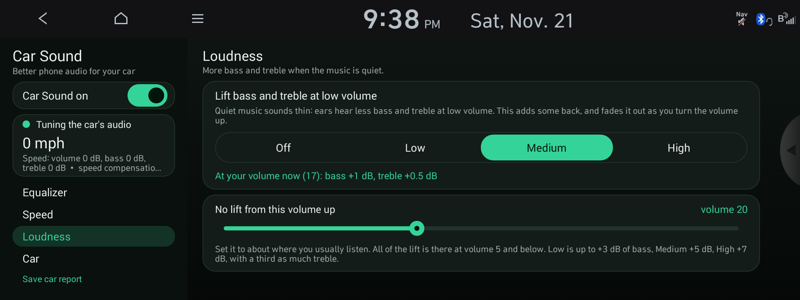
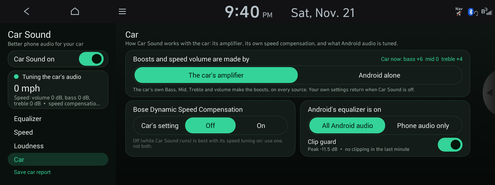

# Car Sound

An [HMG-API](https://github.com/Open-HMG/HMG-API) mod for better sound on Hyundai, Kia and
Genesis Gen5W head units, tuned on a 2024 Ioniq 5 Limited with the Bose system.


- **Equalizer:** 5 bands (60 Hz, 230 Hz, 910 Hz, 3.6 kHz, 14 kHz) and bass boost, with presets:
  Recommended, Deep bass, Harman car, Highway, Clear, Low volume, Voices, Flat.
- **Speed tuning:** volume, bass and treble that rise with the car's speed, each on its own
  curve: pick Low, Medium, High or Max, or drag the points at 20, 35, 50, 65 and 80 mph.
- **Loudness:** bass and treble lifted when the volume is low, fading out as you turn it up.
- **With the car's amplifier:** Car Sound makes its boosts with the car's own Bass, Mid, Treble
  and volume, and uses Android's equalizer only to cut. The boosts are real (Android 4.4's
  equalizer turns everything else down by its largest boost instead), they reach every source,
  and the speed volume is the car's own volume, like the knob. Your own settings come back
  when Car Sound is off. On by default on the Bose system; see
  [docs/AMPLIFIER.md](docs/AMPLIFIER.md) for other amplifiers.
- **From the start, on all Android audio:** the equalizer is on Android's whole output from the
  moment the head unit starts, so nothing changes when music begins. "Phone audio only" limits
  it to Android Auto and CarPlay.
- **Car page:** who makes the boosts, the car's own speed compensation (Bose DSC, or Speed
  Dependent Volume, shown only on a car that has it) left as set, off while Car Sound runs, or
  on, and a clip guard.
- **Car reports:** Save car report writes what's needed to tune Car Sound for a car, for an
  issue.

Turned off or removed, the sound is as it was.

[](https://ko-fi.com/X3V32AZ1FO)

## Screenshots

On the head unit of a 2024 Ioniq 5 Limited (Bose).

**Speed:** pick a level, or drag the points to set how much louder (or how much more bass or
treble) it gets at each speed. The faint lines are the other two curves.


**Loudness:** how much to lift bass and treble at low volume, and the volume where the lift ends.



**Car:** the car's amplifier or Android alone, the car's own speed compensation, and what
Android audio is tuned.



**The app menu:** Car Sound's tile, after the head unit's first restart.


## Install

Needs HMG-API 1.1.0 (or one of its release candidates) on the head unit.

From a [release](../../releases), take one of:

| File | How |
| --- | --- |
| `car-sound-<version>.zip` | the HMG-API app: Updates, from a USB stick |
| `car-sound-<version>-nemesis.zip` | NEMESIS, from a USB stick |
| `car-sound-<version>-nemesis-package.zip` | the NEMESIS Package Store |

Restart the head unit once after installing or updating: the Car Sound tile in the app menu
shows after that, and an update from 0.5.0 or older needs it for the all-audio equalizer (until
then Car Sound tunes phone audio only, and says so). Settings apply as you change them.

## How it works

`svc/engine.sh` runs Car Sound's engine (`engine.jar`) as an HMG-API service. At its start it
puts Android's Equalizer, BassBoost, LoudnessEnhancer and a Visualizer (a meter, for the clip
guard) on Android's output mix. Every second it reads the car's speed from HMG-API (`hmgapid
vehicle speed`) and the car's volume, and moves the speed curves and the loudness lift toward
them. With the car's amplifier, it splits the equalizer's shape into steps of the car's Bass,
Mid and Treble plus cuts for Android's equalizer, adds the lifts as more steps, and makes the
speed volume with the car's own volume for the source that's playing; all through the car's
audio service, the calls its own Sound settings and volume knob make. The app (`CarSound.apk`,
Android 4.4) saves its settings through HMG-API's settings store; the engine picks them up
when they change.

Android 4.4 suspends effects on the output mix while any app has an effect enabled on its own
audio session, and keeps them suspended until the audio service restarts if such an app is
killed. So Car Sound keeps off the sessions of that output, stops through a stop file rather
than a kill, and falls back to Android Auto's and CarPlay's own sessions if it finds its
effects suspended.

## Other cars

The equalizer uses standard Android audio effects and needs no hook points, so it should work
on any Gen5W head unit that plays audio through Android's mixer:

- The five equalizer settings are spread over whatever bands the head unit's equalizer has, by
  frequency, within the levels it takes (the engine's log lists them).
- **The car's amplifier** is used by default only on the Bose system, where it was tuned by ear.
  On other amplifiers (the head unit's own, Mobis, Harman) Car Sound starts with "Android
  alone"; you can choose the amplifier on the Car page, but how many dB a step is and how far
  each control reaches are guesses there. [docs/AMPLIFIER.md](docs/AMPLIFIER.md) has the tests,
  and a car report tells us what to set.
- The speed compensation switch shows only when the car says it has the setting: the engine
  asks its audio service `getSoundAvailability`, the same check the car's own Sound settings
  make (Bose DSC on a Bose amplifier, Speed Dependent Volume on others).
- Speed tuning needs HMG-API to read the car's speed. Where it can't, the status says so and the
  rest still works.
- If Android's audio effects can't attach on a head unit, the status says so, with the error.

Only the 2024 Ioniq 5 Limited (Bose) has been tried. If it doesn't work on your car, open a
[Car report](../../issues/new?template=car-report.yml) issue with a car report (Save car report),
or `hmgapid service-log car-sound engine`.

## Build

Needs Java 17, the Android SDK (build-tools and a platform `android.jar`; `ANDROID_HOME`, or
`~/Library/Android/sdk`), python3, curl and zip.

```sh
sh build.sh                 # out/car-sound-<version>.zip, signed with a throwaway author key
sh test/run.sh              # off-car tests, and a test build
sh install.sh               # install the latest build on the head unit over adb (HMG-API's adb mod)
```

`tools/sdk.sh` downloads the HMG-API mod SDK `hmgapi-sdk.json` pins into `.hmgapi/` and checks
its SHA-256; set `HMGAPI_SDK` to use another. The app is signed with `keys/car-sound-app.p12`
(made on the first build; `APP_KEYSTORE` and `APP_KEYSTORE_PASS` for another), and the mod with
the HMG-API author key given as `build.sh`'s argument. Android and HMG-API only update an
installed copy from the same keys: keep both.

## Release

1. Set the version in `car-sound/mod.json` and `android:versionName` (and bump
   `android:versionCode`) in `car-sound/src/app/AndroidManifest.xml`, and add it to
   `CHANGELOG.md`.
2. Releases, Draft a new release, tag `v<version>`, Publish.

The Release workflow tests, builds and signs it, makes the NEMESIS packages, and attaches them
with `SHA256SUMS`. It needs these repository secrets:

| Secret | What |
| --- | --- |
| `HMGAPI_AUTHOR_KEY` | the HMG-API author key file's contents |
| `CAR_SOUND_APP_KEYSTORE` | the app keystore (`.p12`), base64 |
| `CAR_SOUND_APP_KEYSTORE_PASS` | its password |

## License

AGPL-3.0: see [LICENSE](LICENSE).
