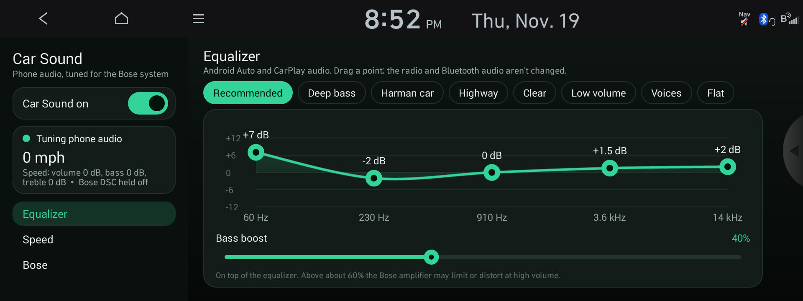
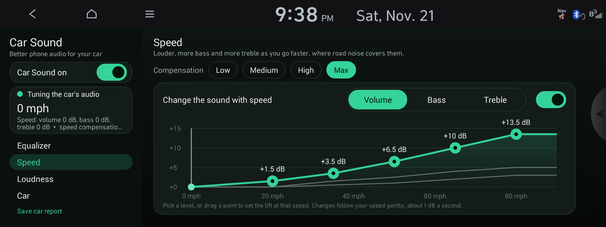
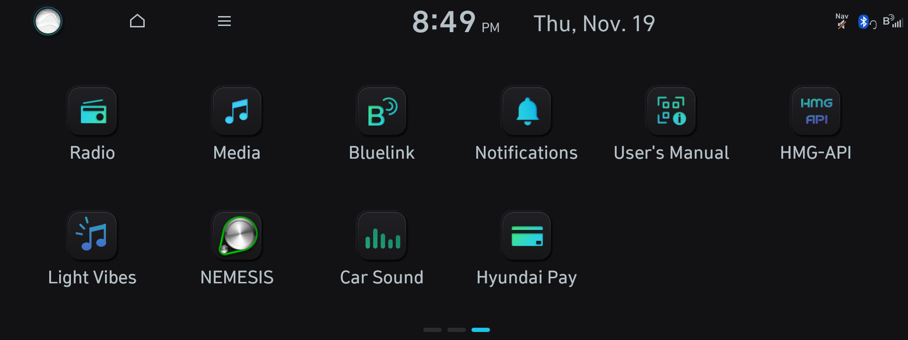

# Car Sound

An [HMG-API](https://github.com/Open-HMG/HMG-API) mod for better phone audio on Hyundai, Kia
and Genesis Gen5W head units, tuned on a 2024 Ioniq 5 Limited with the Bose system.



- **Equalizer:** 5 bands (60 Hz, 230 Hz, 910 Hz, 3.6 kHz, 14 kHz; ±12 dB) and bass boost on
  Android Auto and CarPlay audio, with presets: Recommended, Deep bass, Harman car, Highway,
  Clear, Low volume, Voices, Flat.
- **Speed tuning:** volume, bass and treble that rise with the car's speed, each on its own
  curve: drag the points at 20, 35, 50, 65 and 80 mph. Changes ease in at 1 dB a second.
- **Bose DSC** (cars with the Bose system): the car's Dynamic Speed Compensation left as set,
  off while Car Sound runs (so the two don't stack), or on. On other cars the page isn't shown
  and the setting is never touched.

Radio, Bluetooth and the car's own sounds are left alone. Turned off or removed, the sound is
as it was.
[](https://ko-fi.com/X3V32AZ1FO)
## Screenshots

On the head unit of a 2024 Ioniq 5 Limited (Bose).

**Speed:** drag the points to set how much louder (or how much more bass or treble) phone audio
gets at each speed. The faint lines are the other two curves.



**The app menu:** Car Sound's tile, after the head unit's first restart.



## Install

Needs HMG-API 1.1.0 (or one of its release candidates) on the head unit.

From a [release](../../releases), take one of:

| File | How |
| --- | --- |
| `car-sound-<version>.zip` | the HMG-API app: Updates, from a USB stick |
| `car-sound-<version>-nemesis.zip` | NEMESIS, from a USB stick |
| `car-sound-<version>-nemesis-package.zip` | the NEMESIS Package Store |

Restart the head unit once after the first install: the Car Sound tile in the app menu shows
after that. Settings apply as you change them.

## How it works

`svc/engine.sh` runs Car Sound's engine (`engine.jar`) as an HMG-API service. Every two seconds
it finds the Android Auto (`com.google.android.projection.sink`) and CarPlay
(`com.daudio.app.dipo`) audio sessions and attaches Android's Equalizer, BassBoost and
LoudnessEnhancer effects to them. Every second it reads the speed from HMG-API (`hmgapid
vehicle speed`) and moves the speed curves toward it. The app (`CarSound.apk`, Android 4.4)
saves its settings through HMG-API's settings store; the engine picks them up when they change.

## Other cars

The equalizer and speed tuning use standard Android audio effects and need no hook points, so
they should work on any Gen5W head unit that plays phone audio through Android's mixer:

- The five equalizer settings are spread over whatever bands the head unit's equalizer has, by
  frequency, within the levels it takes (the engine's log lists them).
- The Bose page shows only when the car says it has Bose DSC: the engine asks its audio service
  `getSoundAvailability(47)`, the same check the car's own Sound settings make.
- Speed tuning needs HMG-API to read the car's speed. Where it can't, the status says so and the
  rest still works.
- If Android's audio effects can't attach on a head unit, the status says so, with the error.

Only the 2024 Ioniq 5 Limited (Bose) has been tried. If it doesn't work on your car, open an
issue with `hmgapid service-log car-sound engine`.

## Build

Needs Java 17, the Android SDK (build-tools and a platform `android.jar`; `ANDROID_HOME`, or
`~/Library/Android/sdk`), python3, curl and zip.

```sh
sh build.sh                 # out/car-sound-<version>.zip, signed with a throwaway author key
sh test/run.sh              # off-car tests, and a test build
sh install.sh               # install the latest build on the head unit over adb (HMG-API's adb mod)
```

`tools/sdk.sh` downloads the HMG-API mod SDK `hmgapi-sdk.json` pins into `.hmgapi/` and checks
its SHA-256; set `HMGAPI_SDK` to use another. The app is signed with `keys/car-sound-app.p12`
(made on the first build; `APP_KEYSTORE` and `APP_KEYSTORE_PASS` for another), and the mod with
the HMG-API author key given as `build.sh`'s argument. Android and HMG-API only update an
installed copy from the same keys: keep both.

## Release

1. Set the version in `car-sound/mod.json` and `android:versionName` (and bump
   `android:versionCode`) in `car-sound/src/app/AndroidManifest.xml`, and add it to
   `CHANGELOG.md`.
2. Releases, Draft a new release, tag `v<version>`, Publish.

The Release workflow tests, builds and signs it, makes the NEMESIS packages, and attaches them
with `SHA256SUMS`. It needs these repository secrets:

| Secret | What |
| --- | --- |
| `HMGAPI_AUTHOR_KEY` | the HMG-API author key file's contents |
| `CAR_SOUND_APP_KEYSTORE` | the app keystore (`.p12`), base64 |
| `CAR_SOUND_APP_KEYSTORE_PASS` | its password |

## License

AGPL-3.0: see [LICENSE](LICENSE).
